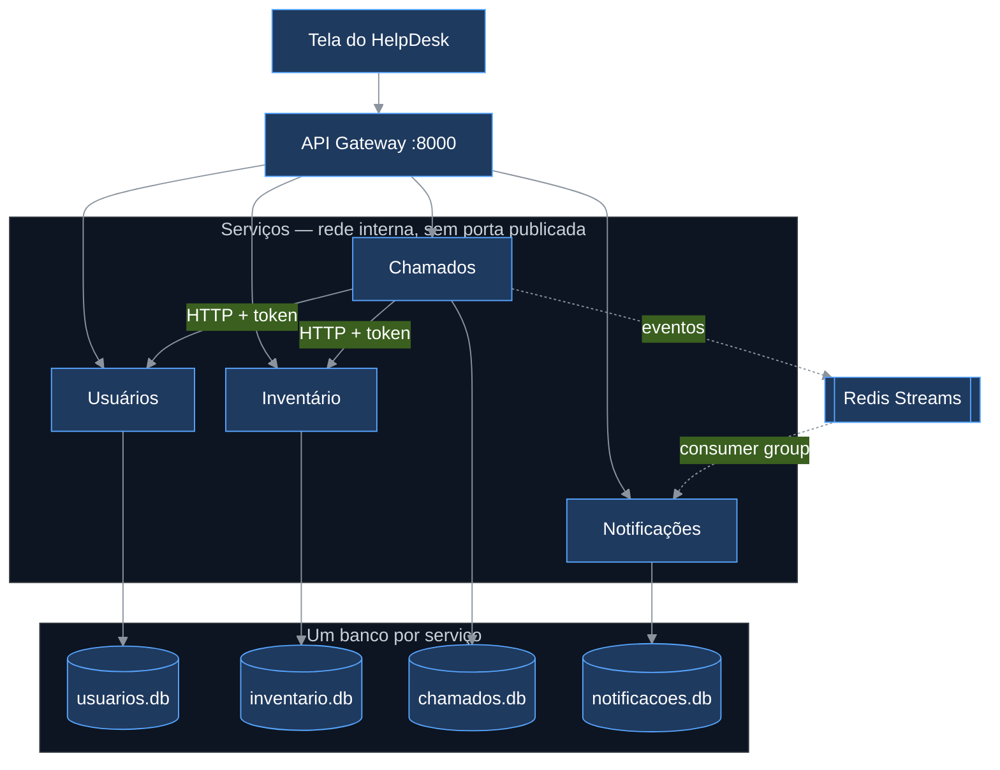

# HelpDesk TI em microsserviços

Sistema de chamados de TI (no estilo de um GLPI simplificado) feito em **Python + FastAPI**,
agora dividido em **serviços independentes**, cada um com o seu banco, atrás de um **API Gateway**.

> 🎬 **Vídeo de demonstração:** [assistir no YouTube](https://youtu.be/NnQzSazOsPM)
>
> Projeto da disciplina **Arquitetura de Software** - transformação do monólito `helpdesk-ti`
> em microsserviços.

## O que mudou em relação ao monólito

| | Monólito | Microsserviços |
|---|---|---|
| Processos | 1 aplicação | 4 serviços + gateway (+ Redis) |
| Banco | 1 banco com todas as tabelas | 4 bancos separados (um por serviço) |
| Chamados → Usuários | chamada de função | `GET /usuarios/{id}` por HTTP, com timeout |
| Chamados → Inventário | chamada de função | `GET /ativos/{id}` por HTTP, com timeout |
| Notificações | chamada de função | evento no Redis Streams, consumido por outro serviço |
| Chaves estrangeiras | entre tabelas de módulos diferentes | não existem entre serviços (só ids) |
| Entrada | porta 8000 da aplicação | porta 8000 do gateway; serviços sem porta publicada |
| Falha de um módulo | derrubava a chamada | erro 503 claro (ou evento perdido, no caso da fila) |

## Arquitetura



| Serviço | Responsabilidade | Porta (interna) | Banco |
|---|---|---|---|
| `gateway` | tela, roteamento, `/saude` agregado | **8000 (única publicada)** | — |
| `usuarios` | login, `/auth/eu`, cadastro de usuários | 8000 | `usuarios.db` |
| `inventario` | cadastro e consulta de ativos | 8000 | `inventario.db` |
| `chamados` | chamados, status, comentários, painel, SLA | 8000 | `chamados.db` |
| `notificacoes` | consome eventos e guarda os avisos | 8000 | `notificacoes.db` |
| `redis` | fila de eventos (Redis Streams) | 6379 | — |

Dentro do Docker, os serviços se encontram pelo nome (`http://usuarios:8000`).
Fora dele, os defaults são `localhost:8001` (Usuários), `8002` (Inventário),
`8003` (Chamados) e `8004` (Notificações).

## Como rodar

Pré-requisito: **Docker** com Compose.

```bash
# 1. Configure o segredo (o arquivo .env não vai para o Git)
cp .env.example .env          # no Windows PowerShell: Copy-Item .env.example .env

# 2. Gere um segredo e cole em JWT_SEGREDO= no .env
python -c "import secrets; print(secrets.token_urlsafe(48))"

# 3. Suba tudo
docker compose up --build
```

Em outro terminal:

```bash
docker compose ps          # todos os serviços "healthy"
docker compose logs -f     # acompanhar os logs
```

Abra **http://localhost:8000** — a tela do HelpDesk, servida pelo gateway.
O `GET http://localhost:8000/saude` mostra quais serviços estão no ar.

> O `.env` precisa existir antes do `docker compose up`; sem `JWT_SEGREDO` o Compose
> para com uma mensagem clara, para nunca haver segredo escrito no código.

### Contas de acesso

Todas usam a senha **`Helpdesk2026`** (definida em `SENHA_EXEMPLO`):

| E-mail | Perfil | O que pode fazer |
|---|---|---|
| `admin@empresa.com` | Administrador | Tudo, inclusive cadastrar usuários |
| `carla@empresa.com` | Técnica | Ver todos os chamados, atribuir, resolver e cadastrar equipamentos |
| `diego@empresa.com` | Técnico | O mesmo que a Carla |
| `ana@empresa.com` | Solicitante | Abrir chamados e ver só os próprios |
| `bruno@empresa.com` | Solicitante | O mesmo que a Ana |

Os dados de exemplo só são criados com `DADOS_EXEMPLO=1` (padrão) e apenas quando o banco está vazio.
Em produção, use `DADOS_EXEMPLO=0` e `DOCS=0`.

## Decisões de arquitetura

1. **Um banco SQLite por serviço**, cada um em um volume Docker próprio.
   Nenhum serviço abre o arquivo do outro e as *foreign keys* entre módulos foram removidas:
   `chamados.solicitante_id`, `chamados.tecnico_id` e `chamados.ativo_id` são apenas ids,
   conferidos por HTTP na hora de usar.
2. **Login só no serviço de Usuários.** O token JWT (HS256) carrega `sub` e `perfil`;
   cada serviço valida a assinatura com o mesmo `JWT_SEGREDO` e aplica as permissões,
   sem consultar o banco de usuários. Só o serviço de Usuários confere se a conta
   ainda existe/está ativa (é o único que tem essa tabela).
3. **Chamadas HTTP com timeout de 3 s e falha explícita.** Se Usuários ou Inventário
   não responderem, Chamados devolve `503` com mensagem clara; o chamado não é gravado
   pela metade.
4. **Token repassado nas chamadas entre serviços** (`Authorization`), como se fosse o
   próprio usuário perguntando ao outro serviço.
5. **Eventos em Redis Streams com consumer group.** Se Notificações estiver fora, os
   eventos ficam no stream e são entregues quando voltar; se o Redis cair, o Chamados
   continua abrindo chamados (a publicação só registra um aviso no log).
6. **Gateway em FastAPI + httpx**, sem regra de negócio: serve a tela, repassa métodos,
   corpo, query string e token, e devolve 503 se o destino estiver fora.
7. **Código comum em `comum/`**: tokens, erros, cabeçalhos de segurança e fábrica de app.
   Evita que a regra de segurança fique diferente de um serviço para outro.
8. **A tela continua a mesma.** `app.js` já usava rotas relativas (`API = ""`), então segue
   funcionando atrás do gateway sem alterar endereço nem código; só o texto do cabeçalho
   passou a indicar “microsserviços”.

## Segurança

- **Só o gateway publica porta** (`127.0.0.1:8000`). Serviços, Redis e bancos ficam na
  rede interna do Compose.
- **Todo serviço confere o token** antes de responder (exceto `/saude` e `/auth/login`).
- **Permissões por perfil** mantidas: solicitante só vê/comenta/fecha os próprios
  chamados (chamado alheio responde **404**, sem revelar que existe); só técnicos e
  admins atribuem, resolvem e cadastram ativos; só admin cria usuários.
- **Segredos fora do código**: `JWT_SEGREDO` vem do `.env`.
- **Senhas** continuam guardadas como hash scrypt; bloqueio após 5 tentativas erradas;
  mensagem igual para e-mail inexistente.
- **Validação de entrada** igual ao monólito: campos extras recusados, limites de
  tamanho, corpo de até 64 KB, cabeçalhos CSP/X-Frame-Options etc.
- Contêineres rodam como usuário sem privilégios, com filesystem somente leitura
  (só o volume de dados é gravável), `cap_drop: ALL` e `no-new-privileges`.

## Testes

Cada serviço tem a sua suíte (102 testes no total) e roda sozinho, sem Docker:

```bash
cd servicos/usuarios      && pytest -q   # 23 testes
cd servicos/inventario    && pytest -q   # 13 testes
cd servicos/chamados      && pytest -q   # 29 testes
cd servicos/notificacoes  && pytest -q   # 16 testes
cd gateway                && pytest -q   # 21 testes
```

Os testes de Chamados trocam as chamadas HTTP por funções falsas (e os eventos por uma
lista), então não precisam dos outros serviços no ar. O GitHub Actions roda a matriz
por serviço, o `pip-audit` e valida/constrói o `docker-compose.yml`
([`.github/workflows/microsservicos.yml`](.github/workflows/microsservicos.yml)).

O monólito original continua com os 36 testes dele em `tests/` (referência histórica).

## Estrutura do repositório

```
comum/                     tokens JWT, erros, segurança HTTP, banco, fábrica do app
servicos/
  usuarios/                app/, tests/, Dockerfile, requirements
  inventario/              app/, tests/, Dockerfile, requirements
  chamados/                app/, tests/, Dockerfile, requirements
  notificacoes/            app/, tests/, Dockerfile, requirements
gateway/                   app/ (proxy), web/ (tela), tests/, Dockerfile
docker-compose.yml         serviços, bancos (volumes), Redis e gateway
.env.example               variáveis de ambiente (copie para .env)
app/, tests/, Dockerfile   monólito original, preservado como referência
```

## Rotas principais

Todas passam pelo gateway e exigem login, exceto `/auth/login` e `/saude`.

| Método | Rota | Serviço | O que faz | Quem pode |
|---|---|---|---|---|
| POST | `/auth/login` | Usuários | Entra e recebe o token | Todos |
| GET | `/auth/eu` | Usuários | Dados de quem está logado | Logado |
| POST | `/usuarios` | Usuários | Cria usuário | Admin |
| GET | `/usuarios` | Usuários | Lista usuários (sem e-mail) | Logado |
| GET | `/usuarios/{id}` | Usuários | Consulta um usuário (usado por Chamados) | Logado |
| POST | `/ativos` | Inventário | Cria equipamento | Técnico e admin |
| GET | `/ativos` | Inventário | Lista equipamentos | Logado |
| GET | `/ativos/{id}` | Inventário | Consulta equipamento (usado por Chamados) | Logado |
| POST | `/chamados` | Chamados | Abre chamado em nome de quem está logado | Logado |
| GET | `/chamados` | Chamados | Lista chamados (solicitante vê só os seus) | Logado |
| GET | `/chamados/painel` | Chamados | Totais por status e atrasados | Logado |
| PATCH | `/chamados/{id}/atribuir` | Chamados | Atribui a um técnico | Técnico e admin |
| PATCH | `/chamados/{id}/status` | Chamados | Muda o status | Técnico/admin; solicitante fecha/reabre o seu |
| POST | `/chamados/{id}/comentarios` | Chamados | Comenta no chamado | Envolvidos |
| GET | `/notificacoes` | Notificações | Minhas notificações | Logado |
| GET | `/saude` | Gateway | Quais serviços estão no ar | Todos |

Regras mantidas do monólito: SLA de 4 h (crítica), 8 h (alta), 24 h (média) e 72 h (baixa);
status `aberto → em_atendimento → resolvido → fechado` (reabrir volta para `em_atendimento`);
chamado fechado não recebe comentário.

## Bônus implementados

- [x] Eventos `ChamadoAberto`, `ChamadoAtribuido` e `ChamadoResolvido` em Redis Streams.
- [x] Serviço de Notificações com consumer group (não perde evento se ficar fora).
- [x] Testes por serviço no GitHub Actions (`pytest` + `pip-audit`).
- [x] `GET /saude` em cada serviço e no gateway, mostrando o que está no ar.

## Demonstração da falha de um serviço

```bash
docker compose stop inventario
```

- a tela continua carregando usuários, chamados e painel;
- abrir um chamado **com equipamento** mostra um erro claro (503) em vez de travar;
- `docker compose start inventario` volta ao normal.
